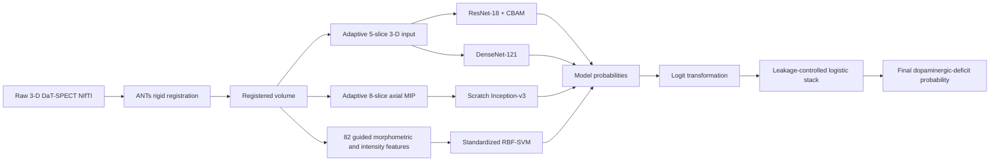

# Final ensemble architecture

The CNN and SVM branches are trained independently. Their out-of-fold logits are combined by a logistic-regression meta-learner. During deployment, the same preprocessing and four model branches produce one final probability per scan.
